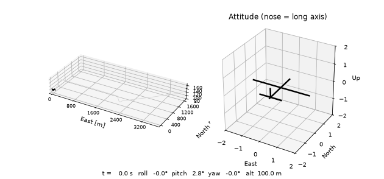
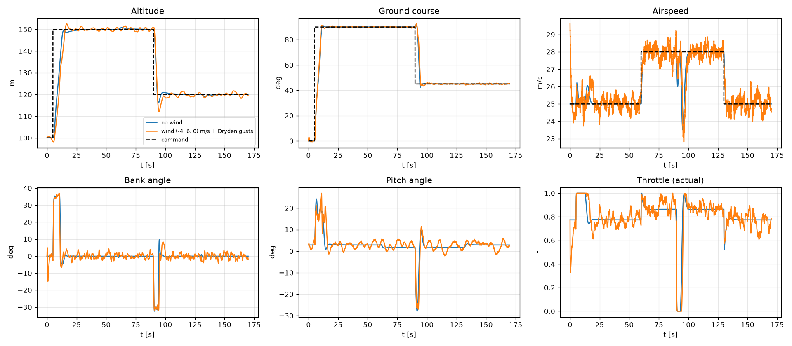
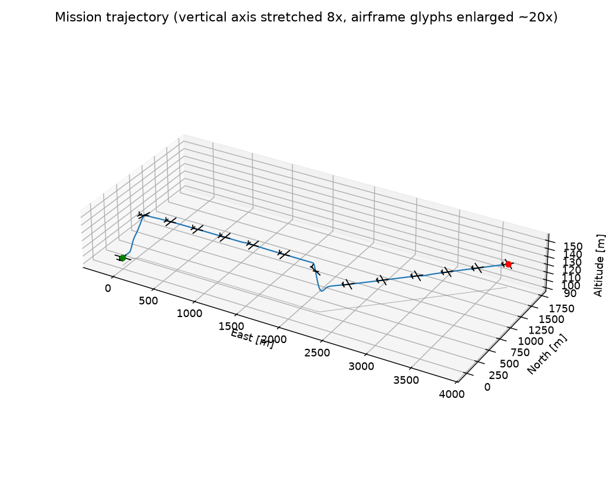
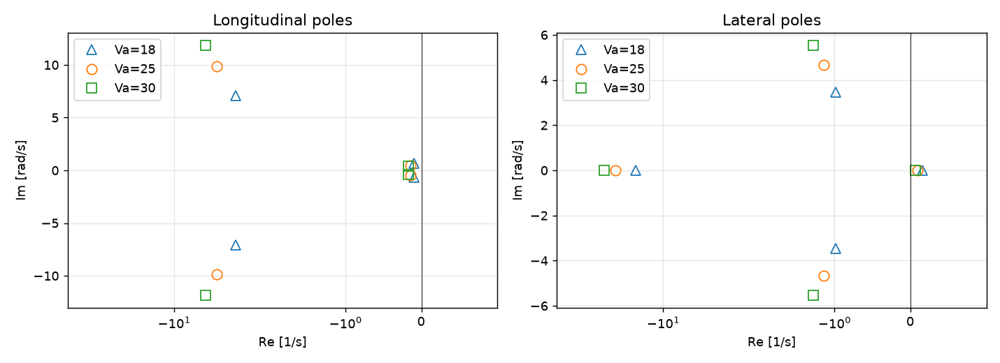
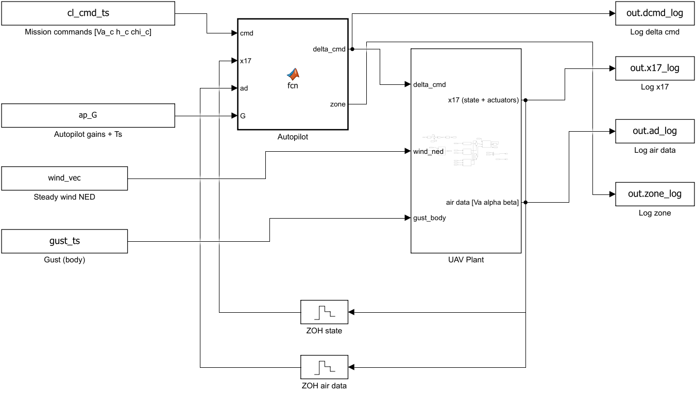
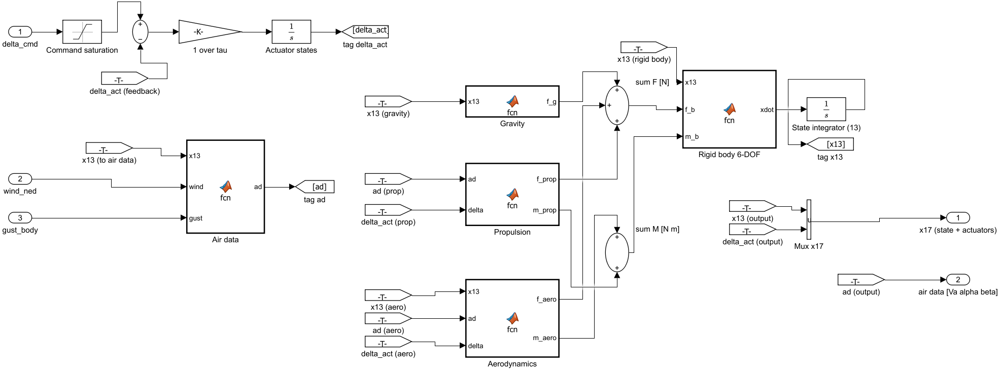
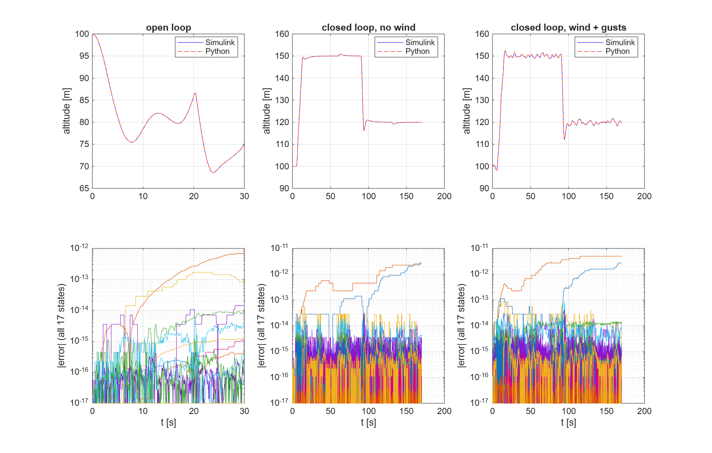

# 6-DOF Fixed-Wing UAV Simulation & Autopilot

A from-scratch nonlinear **6-DOF simulation of the Aerosonde small UAV**, with trim, linearisation and modal
analysis, a successive-loop-closure autopilot tested in wind and turbulence, 3D visualisation, and a MATLAB/Simulink
port validated against the Python reference. Every phase has a derivation note in [`docs/`](docs/) and physics-based tests
(conservation laws, analytic solutions, symmetry, linear-vs-nonlinear consistency) in [`tests/`](tests/).



*Mission: climb 100 → 150 m while turning to course 90°, speed 25 → 28 m/s, descend to 120 m and turn to 45°. Left: flight path and airframe (enlarged);
right: attitude.*

Notation and frames follow Beard & McLain, *Small Unmanned Aircraft: Theory and Practice* (Princeton, 2012). Parameters are read from the
authors' public companion repo (BYU MAGICC `mavsim_public`, commit and file cited in [`params/aerosonde.py`](params/aerosonde.py)).

## Status

| Phase | Topic | Status |
|---|---|---|
| 0 | Setup, tooling, test harness | done |
| 1 | Rigid-body kinematics & dynamics (Euler + quaternion, RK4) | done |
| 2 | Forces & moments: aero, propulsion, actuators, wind/Dryden | done |
| 3 | Trim (level, climb, coordinated turn) | done |
| 4 | Linearization & modal analysis | done |
| 5 | Autopilot (successive loop closure) | done |
| 6 | Visualization & polish | done |
| 7 | MATLAB/Simulink port + cross-validation | done |

Run the whole test-suite with `python -m pytest` (about 80 s); the MATLAB/Simulink validation is opt-in (`RUN_MATLAB_TESTS=1`, a few minutes). Study material: [`docs/interview_prep.md`](docs/interview_prep.md).

## Results at a glance

| | |
|---|---|
| Level trim at 25 m/s | α = 2.85°, δe = −0.124 rad, δt = 0.77; max level speed ≈ 33 m/s |
| Short period | −4.89 ± 9.87j s⁻¹ (ωn 11.0 rad/s, ζ 0.44) |
| Phugoid | −0.14 ± 0.48j s⁻¹ (ωn 0.50, ζ 0.29) |
| Roll subsidence | −22.4 s⁻¹ (τ = 45 ms) |
| Dutch roll | −1.14 ± 4.66j s⁻¹ (ωn 4.8, ζ 0.24) |
| Spiral | **+0.089 s⁻¹ (unstable, doubling time 7.8 s)**, stabilised by the autopilot |
| Autopilot, no wind | final errors < 0.3 m altitude, 0.3° course, 0.2 m/s airspeed |
| Autopilot, 7 m/s wind + Dryden gusts | within 1.5 m, 1.5°, 1 m/s (3 s averages) |
| Closed-loop validation | small steps on the nonlinear plant match the linear closed loop within about 2 % |
| Simulink vs Python | 170 s closed-loop mission with wind and gusts agrees to **1.4e-12** (round-off); autopilot commands and mode switching identical |

<p>

 
</p>

## MATLAB/Simulink port

The plant (actuators, air data, aerodynamics, propulsion, gravity, rigid-body 6-DOF) and the autopilot are rebuilt in Simulink **from a script** (`matlab/build_uav_models.m`), using
only core MATLAB and basic blocks (no Aerospace Blockset or Control System Toolbox), and validated against this Python implementation with identical inputs: see
[docs/07_simulink.md](docs/07_simulink.md) (also: how the setup extends to SIL/HIL).

**Top-level model** (`uav_closed_loop.slx`: mission commands, 100 Hz autopilot MATLAB Function block, ZOH sampling, UAV Plant, gust and wind inputs, logging):



**Plant subsystem** (actuators, air data, aerodynamics, propulsion, gravity, rigid-body 6-DOF, state integrator):



**Validation against Python** (altitude overlays and the absolute error of all 17 states, about 1e-12):



More figures: `results/phase1_*.png` (conservation laws, RK4 order, gimbal lock), `phase2_models.png` (lift/stall, propeller, gusts),
`phase3_trim_map.png`, `phase4_step_compare.png` (linear vs nonlinear), `phase4_modes.md` (mode table at 18/25/30 m/s).

## Model summary

**States** (13 in the quaternion model; the Euler model has 12): NED position `p`, body velocity `V = [u v w]`, attitude (`e` or `φ θ ψ`), body rates `ω = [p q r]`.

    ṗ = Rᵇᵥᵀ V                         V̇ = −ω × V + f/m                    (transport theorem)
    ė = ½ Ω(ω) e                        J ω̇ = −ω × Jω + m                   (Γ₁…Γ₈ closed form)

* **Air data**: `Vₐ = V − (R w_steady + w_gust)`, `α = atan2(w_r, u_r)`, `β = asin(v_r/Vₐ)`.
* **Aerodynamics**: `½ρVₐ²S [C_L(α) + C_Lq c q/2Vₐ + C_Lδe δe]` etc., with `C_L(α)` blended from linear to flat-plate lift by a logistic window; lateral model linear in `β, p, r, δa, δr`.
* **Propulsion**: DC motor + quadratic `C_T(J), C_Q(J)` propeller fit, steady-state torque balance (a quadratic in prop speed).
* **Actuators**: command saturation then first-order lag. **Wind**: steady NED wind + Dryden turbulence (exactly discretised).
* **Trim**: bounded nonlinear least squares on 7 unknowns with full-plant residuals. **Linearisation**: central differences.
* **Autopilot**: roll PD ← course PI; pitch PD ← altitude PI; airspeed PI via throttle (hold zone) or pitch (climb/descend zones); washed-out yaw damper.
  Gains are computed from the linearised model, see [docs/05_autopilot.md](docs/05_autopilot.md).

## Deliberate deviation from the book: yaw damper instead of sideslip hold

Beard & McLain close the rudder loop with a PI sideslip-hold. On this airframe that loop **reduced Dutch-roll damping** in the full linear closed-loop analysis for every gain tried
(with the course/roll loops closed and the sideslip PI added, the minimum closed-loop damping fell, and the single-DOF design formula with ωn = 1 rad/s was unstable through the rudder actuator lag).
A washed-out yaw-rate feedback (`δr = k_r · r_washout`, τ_wash = 1 s, k_r chosen from the (v, r) sub-model for ζ_DR = 0.7) was used instead:

| closed-loop minimum damping ratio (all modes) | value |
|---|---|
| open-loop Dutch roll | 0.24 |
| autopilot **without** yaw damper (roll/course/pitch/altitude/speed loops only) | 0.17 |
| autopilot **with** yaw damper | **0.41** |

Details and the test: [docs/05_autopilot.md](docs/05_autopilot.md), `test_yaw_damper_improves_dutch_roll_damping`.

## Design choices worth knowing

* **Reference implementation in Python**, tested with `pytest`; fixed-step RK4 (deterministic, as required for SIL/HIL), `solve_ivp` only as a reference in tests.
* **Quaternions inside the integrator**, Euler angles for output and design; gimbal-lock behaviour is demonstrated and tested.
* **Single parameter file** [`params/aerosonde.py`](params/aerosonde.py); 61 values are machine-checked against the upstream file by `scripts/check_params_upstream.py`.
* **No toolbox dependency**: no Control System Toolbox / Aerospace Blockset required (Python uses numpy/scipy; the MATLAB port uses core MATLAB and Simulink only).
* **Verification over demonstration**: negative controls (wrong transpose, wrong gain, wrong linear model) are tested to fail where they should.
* **Findings that changed the design**: the book's sideslip-hold PI lowered Dutch-roll damping on this airframe and was replaced by a yaw damper; the altitude-loop bandwidth had to be reduced after
  the full linear closed-loop analysis (docs/05).

## Limitations

* Parameters come from the authors' *current* public repo, which may differ from the printed 2012 Appendix E; the book could not be checked.
* **Actuator constants are project choices, not Aerosonde data**: servo time constant 0.05 s, throttle time constant 0.10 s, ±45° surface limit (marked `NOT FROM SOURCE` in the parameter file). No rate limits or backlash.
* **Motor/propeller equations are my own derivation** (standard DC-motor + `T = ρn²D⁴C_T(J)` convention). The authors' repo supplies only the coefficients, so the equation form is validated by physical tests (torque balance, efficiency < 1, plausible cruise throttle), not against a published reference. Motor/rotor inertia is neglected.
* **Idle-descent limitation**: the quadratic `C_T(J)`, `C_Q(J)` fits are extrapolated at low throttle in fast flight (J ≳ 1.2); e.g. δt = 0 at 25 m/s gives about −22 N thrust. Cruise/trim (δt ≈ 0.6–0.8) is inside the fit, but descents at idle (the autopilot's descend zone) should be read as qualitative.
* Dryden gust parameters (L = 200/200/50 m, σ = 1.06/1.06/0.7 m/s) are from the authors' `mavsim_simulink/parameters/wind_parameters.m`; the shaping filters are the standard Dryden form, verified by tests.
* Motor/propeller *equations* are derived here (the repo only has the coefficients); `C_T(J)` is extrapolated at idle and in fast descents (large negative thrust).
* Flat non-rotating Earth, constant air density, rigid constant-mass airframe, no ground contact, no sensor/estimator models (perfect state feedback).
* Gains are designed at one trim (25 m/s); the loop stays stable from 18 to 30 m/s but is not gain-scheduled.
* This Aerosonde model has an unstable spiral mode (+0.089 s⁻¹): a model property, not a bug (the autopilot stabilises it).

## Repository layout

```
docs/      derivation note per phase (00_setup ... 07_simulink) + interview_prep.md
params/    aerosonde.py: every parameter with its source / flag
sim/       rotations, dynamics, integrators, aero, propulsion, actuators, wind, aircraft, trim,
           linearize, response, autopilot, mission, visualize
tests/     physics verification tests (pytest)
scripts/   figure generation (make_figures.py), upstream parameter check
matlab/    MATLAB/Simulink port: uav_*.m model + autopilot, build_uav_models.m (builds the .slx from a script), validation/
results/   generated figures and animation
```

## How to run

```bash
python -m venv .venv
.venv/Scripts/python -m pip install -r requirements.txt      # Windows (use .venv/bin/python on Linux/macOS)
.venv/Scripts/python -m pytest                                # all tests

.venv/Scripts/python scripts/make_figures.py                  # regenerate every figure + the animation (about 3 min)
# MATLAB/Simulink cross-validation (needs MATLAB + Simulink):
.venv/Scripts/python scripts/make_matlab_reference.py          # Python reference data (about 2 min)
matlab -batch "addpath('matlab/validation'); run_validation"   # build the models, simulate, compare
```

Minimal example:

```python
import numpy as np
from sim import trim, linearize as lin, autopilot as ap, mission

t0 = trim.compute_trim(Va=25.0)                              # level trim
model = lin.linearize(t0)                                    # A, B about the trim
print({k: (round(m.wn, 2), round(m.zeta, 2)) for k, m in lin.modal_summary(model).items()})
gains, _ = ap.design_gains(model)                            # autopilot gains from the linear model
cmds = [(0, 25.0, 100.0, 0.0), (5, 25.0, 150.0, np.deg2rad(90))]   # (t, Va_c, h_c, chi_c)
out = mission.simulate_mission(t0, gains, cmds, T=60.0, wind_ned=(-4, 6, 0), gusts=True)
```

## References

* R. Beard, T. McLain, *Small Unmanned Aircraft: Theory and Practice*, Princeton University Press, 2012.
* BYU MAGICC lab, `mavsim_public` (parameter source): https://github.com/byu-magicc/mavsim_public
